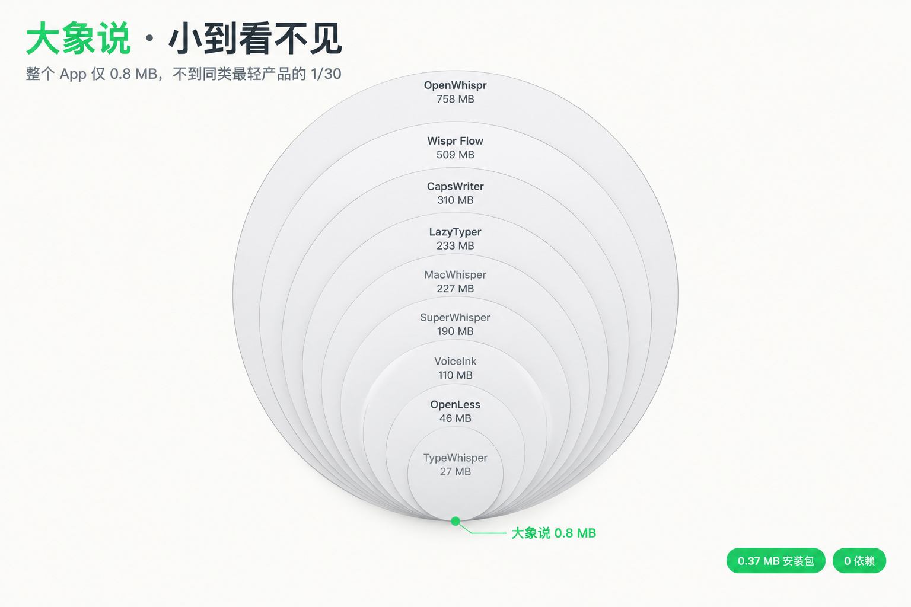

     

## 简介

**大象说**是一个真正意义上“小”的 macOS 语音输入工具。

语音输入工具只该做一件事：把你说的话变成字。所以它做得足够轻 —— 整个应用**仅 900K 大小**，单进程，零第三方依赖，无本地模型，使用当前最适合做语音输入的火山引擎双向流式语音模型。

## 快速开始

在 [Releases 页面](https://github.com/xhat/eput/releases/latest)下载最新版本，配置API KEY，根据提示授予**麦克风**与**辅助功能**权限。

默认触发快捷键：左alt

> 语音识别在云端完成，需要联网和自备 API Key，音频会上传到你所配置的服务商。

## 许可证

MIT